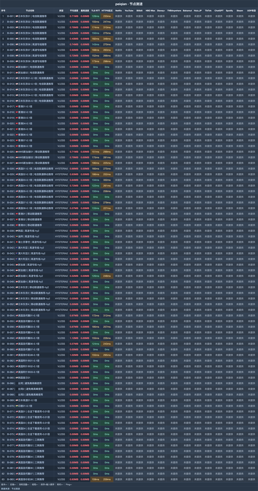

# 赔钱机场｜100G 月付 1.5 元，低倍率与大流量一起比较（2026-11-06 更新）

> **一句话评价：0.1 倍节点让同额度对应约 10 倍传输量，水桶可乐提供 20TB，另有企业与不限时产品。**
>
> 👉 **[官网注册](https://xn--mes358aby2apfg.com/register?code=qhyiSP1G&cover=sfw)** · 从 1.5 元月付试起，先确认常用地区与运营商是否适配。

**适合：**

- 下载、PT 或 4K 消耗较多，希望优先比较大流量套餐。
- 特别关注 0.1 倍计费，愿意按节点倍率管理用量。
- 主要使用美区线路，低倍率节点集中在这个地区。

**不适合：**

- 需要把整份订阅里的每个节点都当作可用线路，该轮并非全部连通。
- 不愿关注每日额度规则，买前应先接受套餐的公平使用限制。

| 选购项 | 内容 |
|---|---|
| 月付起点 | 1.5 元/月 100G |
| 节点记录 | 83 个，26 个连通 |
| 延迟中位 | 154 ms |
| 速度中位 | 6.5 MB/s |
| 最快平均速度 | 9.2 MB/s |
| 低倍率节点 | 12 个 0.1 倍节点 |
| 协议 | VLESS / Hysteria2 |

**关于赔钱机场**：赔钱机场（peiqian）以可乐系列区分周期流量包，再提供不限时订阅与企业档。选赔钱机场不能只看标称流量：常用节点的地区、倍率和当日用量规则同样影响使用方式。

## 套餐

| 套餐名称 | 流量 | 设备 | 限速 | 一次付 | 月付 | 季付 | 半年 | 年付 | 两年 | 三年 |
|---|---|---|---|---|---|---|---|---|---|---|
| 大瓶可乐 | 1000G | 20 | 不限 | — | **5.99 元** | — | 34.99 | 68.99 | 133.99 | 199.99 |
| 超大瓶可乐 | 5000G | 30 | 不限 | — | **12.99 元** | — | 73.99 | 139.99 | 265.99 | 375.99 |
| 水桶可乐 | 20000G | 40 | 不限 | — | **39.99 元** | — | 225.99 | 429.99 | 810 | 1150.99 |
| 中瓶可乐 | 500G | 15 | 不限 | — | **2.99 元** | — | 17.99 | 34.99 | 68.99 | 99.99 |
| 一瓶盖可乐 | 100G | 10 | 不限 | — | **1.50 元** | — | 9 | 18 | 36 | 54 |
| 企业套餐(300台设备数量支持) | 99999G | 300 | 不限 | — | **280 元** | 798 | 1515 | 2888 | 5488 | 8088 |
| 一会嗦一口(不限时长永久订阅) | 1000G 一次性 | 10 | 不限 | **18.90 元** | — | — | — | — | — | — |
| 一会嗦(不限时长永久订阅) | 4000G 一次性 | 20 | 不限 | **68.90 元** | — | — | — | — | — | — |
| 一大口(不限时长永久订阅) | 6000G 一次性 | 30 | 不限 | **88.99 元** | — | — | — | — | — | — |
| 至尊订阅(不限时长永久订阅) | 20000G 一次性 | 40 | 不限 | **228.80 元** | — | — | — | — | — | — |
| 顶级王冠99999GB流量订阅(不限时长永久订阅) | 99999G 一次性 | 300 | 不限 | **688 元** | — | — | — | — | — | — |

> 每日规则写为“每天流量限制为总的20%”。0.1 倍节点按同额度扣量，实际可传数据约为标称 10 倍。月付每元流量约 67～500 GB/元，范围从一瓶盖可乐到水桶可乐。

## 测速

这一轮收录 **83 个节点**，**26 个连通**；最快节点平均速度为 **9.2 MB/s**。先比较下表的高均速记录，再按常用地区试线；图示位置见下图。

测试时间为 **2026-10-17 18:39–18:48**；环境为中国大陆家宽出口香港，每节点连测 **3 次取最优**。

| 节点名称 | 协议类型 | 延迟 | 完整请求 | 平均速度 | 最高速度 |
|---|---|---|---|---|---|
| 🇺🇸美国圣何塞05-0.1倍 | VLESS | 152ms | 223ms | **9.15 MB/s** | 11.14 MB/s |
| 🇺🇸美国07-0.1倍 \| 电信联通移动推荐 | HYSTERIA2 | 149ms | 280ms | **8.92 MB/s** | 11.15 MB/s |
| 🇺🇸美国洛杉矶08-0.1倍 | VLESS | 151ms | 292ms | **8.34 MB/s** | 11.60 MB/s |
| 🇺🇸美国圣何塞01-0.1倍 | VLESS | 177ms | 308ms | **7.91 MB/s** | 10.87 MB/s |
| 🇺🇸美国洛杉矶08 \| 三网推荐 | VLESS | 158ms | 261ms | **7.58 MB/s** | 12.01 MB/s |
| 🇯🇵日本东京07 \| 高速专线推荐 | VLESS | 165ms | 262ms | **7.54 MB/s** | 12.35 MB/s |
| 🇺🇸美国02-0.1倍 \| 电信联通移动推荐 | HYSTERIA2 | 184ms | 254ms | **7.52 MB/s** | 10.97 MB/s |
| 🇺🇸美国圣何塞03-0.1倍 | VLESS | 186ms | 264ms | **7.15 MB/s** | 11.66 MB/s |

**地区分布**：83 个节点按地区展开：美国 32、日本 20、香港 11、新加坡 9、台湾 3、澳大利亚 3、韩国 2，迪拜/瑞士/印度各 1。低倍率的 0.1 倍节点主要在美区。

## 怎么选

- 起步先买 1.5 元月付，日常优先试 0.1 倍节点：同样传输量只按十分之一扣除额度。
- 若美区是主要用途，把美国节点放在候选前列；要更大的月配额，再对比可乐系列而非只看订阅总节点数。
- 按自己的运营商查看名称中的“电信联通推荐”“三网推荐”，先测试匹配线路；不能接受每日 20% 用量规则的用户不要只冲着大流量下单。

## 注册

👉 **[官网注册](https://xn--mes358aby2apfg.com/register?code=qhyiSP1G&cover=sfw)** · 从 1.5 元月付试起，先确认常用地区与运营商是否适配。

*本文含推广链接，经此入口注册或购买，本站可能获得佣金。*

## 更新

- **2026-11-06** — 每日复核：套餐、价格与公告无变化；多账号发布对齐核查完成。
- **2026-11-05** — 每日复核：套餐、价格与公告无变化；多账号发布对齐核查完成。
- **2026-11-04** — 每日复核：套餐、价格与公告无变化；多账号发布对齐核查完成。
- **2026-10-18** — 已有套餐复核记录保留一瓶盖可乐 1.5 元月付，公告无新增记录。
- **2026-10-17** — 留存 83 个节点的测试结果，26 个连通，0.1 倍节点共 12 个。

---
*测速记录日期 2026-10-17 18:39–18:48，中国大陆家宽出口香港，每节点连测 3 次取最优。*
*价格与套餐以商家实时显示为准。*

展开相关搜索词

相关关键词：赔钱机场、peiqian、赔钱机场测评、赔钱机场套餐、赔钱机场官网、赔钱机场注册、赔钱机场入口、赔钱机场测速、机场推荐、机场测评、机场推荐2026、科学上网、clash订阅、代理订阅、VPN

