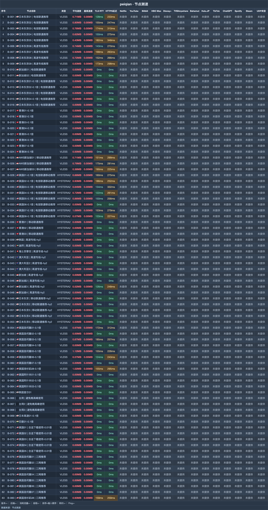

# 赔钱机场价格与套餐怎么选｜1.5 元试线、大流量月付、低频不限时（2026-11-22 更新）

> **赔钱机场价格结论先说：三类需求走三条购买路线。**第一次用，选 **1.5 元/月 100G** 试线；确认线路合用且月流量明显超过 100G，再比较 **2.99 元 500G** 与 **5.99 元 1000G** 的大流量月付；使用月份不连续，才看 **18.90 元一次付 1000G** 的低频不限时包。赔钱机场 0.1 倍节点能降低扣量，但不能忽略每日总流量 20% 的限制与本轮节点连通情况。
>
> 👉 **[官网注册](https://xn--mes358aby2apfg.com/register?code=qhyiSP1G&cover=sfw)** · 先按需求选路：1.5 元试线 / 大流量月付 / 低频不限时；确认常用美区节点与运营商适配后再升档。

## 赔钱机场价格与套餐：三路购买速览

| 需求 | 优先看哪档 | 价格 | 流量与设备 | 购买判断 |
|---|---|---:|---|---|
| 最低成本试用 | 一瓶盖可乐 | **1.50 元/月** | 100G、10 台 | 先验证线路和 0.1 倍节点是否适合 |
| 普通大流量 | 中瓶可乐 | **2.99 元/月** | 500G、15 台 | 月流量明显超过 100G 时更直接 |
| 1000G 月流量 | 大瓶可乐 | **5.99 元/月** | 1000G、20 台 | 持续每月使用比不限时包门槛低 |
| 低频、跨月使用 | 一会嗦一口 | **18.90 元一次付** | 1000G、10 台 | 不限时，用完为止 |
| 极高月流量 | 水桶可乐 | **39.99 元/月** | 20000G、40 台 | 必须同时接受每日 20% 规则 |

**赔钱机场怎么样选最省事：**连续月付按 100G、500G、1000G 的实际需求逐档选，不要只看“20TB”大数；低频、跨月使用才买不限时包。无论哪条路线，都先确认常用地区，因为 0.1 倍节点主要集中在美区。

**适合：**

- 想用 1.5 元把第一次购买成本压到很低。
- 下载、PT 或 4K 消耗较多，需要 500G 以上月流量。
- 常用美区线路，愿意优先选择 0.1 倍节点管理扣量。
- 月份之间用量不连续，需要不限时流量包。

**不适合：**

- 不能接受“每天流量限制为总的 20%”这一规则。
- 需要整份订阅中每个节点都可用；本轮为 83 个节点中 26 个连通。
- 常用地区不是美区，却只因为 0.1 倍节点数字购买。

## 核心购买指标

| 选购项 | 内容 |
|---|---|
| 月付起点 | 1.5 元/月 100G |
| 不限时起点 | 18.90 元一次付 1000G |
| 节点记录 | 83 个，26 个连通 |
| 延迟中位 | 154 ms |
| 速度中位 | 6.5 MB/s |
| 最快平均速度 | 9.2 MB/s |
| 低倍率节点 | 12 个 0.1 倍节点 |
| 协议 | VLESS / Hysteria2 |
| 关键限制 | 每天流量限制为总的 20% |

## 全部套餐价格表

### 可乐月付系列：适合连续按月使用

| 套餐名称 | 流量 | 设备 | 月付 | 半年 | 年付 | 两年 | 三年 |
|---|---:|---:|---:|---:|---:|---:|---:|
| 一瓶盖可乐 | 100G | 10 | **1.50 元** | 9 | 18 | 36 | 54 |
| 中瓶可乐 | 500G | 15 | **2.99 元** | 17.99 | 34.99 | 68.99 | 99.99 |
| 大瓶可乐 | 1000G | 20 | **5.99 元** | 34.99 | 68.99 | 133.99 | 199.99 |
| 超大瓶可乐 | 5000G | 30 | **12.99 元** | 73.99 | 139.99 | 265.99 | 375.99 |
| 水桶可乐 | 20000G | 40 | **39.99 元** | 225.99 | 429.99 | 810 | 1150.99 |
| 企业套餐 | 99999G | 300 | **280 元** | 1515 | 2888 | 5488 | 8088 |

月付系列约为 **67～500 GB/元**，其中水桶可乐的纸面每元流量最高。这个换算不能替代每日 20% 规则、节点连通与地区适配判断。

### 不限时订阅：适合低频跨月使用

| 套餐名称 | 流量 | 设备 | 一次付 |
|---|---:|---:|---:|
| 一会嗦一口 | 1000G | 10 | **18.90 元** |
| 一会嗦 | 4000G | 20 | **68.90 元** |
| 一大口 | 6000G | 30 | **88.99 元** |
| 至尊订阅 | 20000G | 40 | **228.80 元** |
| 顶级王冠 99999GB 流量订阅 | 99999G | 300 | **688 元** |

不限时包的购买理由是跨月保存额度。若每月都会持续使用，同流量下先比较月付系列，不要把一次付总价和单月价格直接并排判断。

## 按预算和用量怎么选：试线、月付、不限时三条路

| 购买路线 | 先选哪档 | 什么时候升级 |
|---|---|---|
| **1.5 元试线** | 一瓶盖可乐，100G / 10 台 | 常用地区、运营商线路与晚高峰验证通过后再升档 |
| **大流量月付** | 2.99 元 500G 或 5.99 元 1000G | 连续每月使用且真实月消耗超过起步档时 |
| **低频不限时** | 18.90 元一次付 1000G | 用量跨月、不连续，月付额度容易浪费时 |

### 预算 1.5 元：先核线路，而不是先追大流量

一瓶盖可乐提供 100G 与 10 台设备，适合验证常用运营商名称对应的线路、美区低倍率节点和客户端使用。确认线路合用且 100G 不够，再升级，避免第一次直接买 5000G 或 20000G。

### 每月 100～1000G：在三档内按真实用量选

- 100G：1.50 元的一瓶盖可乐。
- 500G：2.99 元的中瓶可乐。
- 1000G：5.99 元的大瓶可乐。

500G 档只比起步档多不到 1.5 元，1000G 档比 500G 档多 3 元。先用真实月消耗定档，不因高档每元流量更好就提前买过量。

### 每月超过 1000G：把每日限制一起算

5000G、20000G 与 99999G 档的标称流量很大，但每天可用量仍受“总的 20%”规则约束。购买前先确认自己的高峰用量是否集中在少数日期；如果是，套餐总量大也不等于当天可以任意集中消耗。

### 用量不连续：不限时包比月付更好管理

18.90 元一次付 1000G 是不限时产品的最低门槛。它比 5.99 元月付 1000G 贵，差异在使用期限，不是同周期下更便宜。连续按月使用选月付；几个月才用完一包，再看不限时。

## 0.1 倍节点如何影响性价比

12 个 0.1 倍节点按十分之一扣量，同额度理论上对应约 10 倍传输量。这个优势有三个边界：

1. 低倍率节点主要集中在美区，不等于所有地区都按 0.1 倍扣量。
2. 先确认节点连通和自己的运营商适配，再计算倍率收益。
3. 每日总量规则仍然存在，低倍率不能取消套餐限制。

## 套餐陷阱与限制

1. **“500 GB/元”不是任意场景的实际可用量承诺。** 它来自套餐标称流量除以月付价格，仍受周期、节点倍率与每日规则影响。
2. **20TB 套餐不等于一天可用 20TB。** 每天流量限制为总量的 20%。
3. **0.1 倍优势有地区集中性。** 常用香港、日本或其他地区时，不要用美区低倍率替代自己的地区需求。
4. **月付和不限时包周期不同。** 5.99 元月付 1000G 与 18.90 元一次付 1000G，核心差异是有效周期。
5. **不存在本文已核的优惠码或限时折扣。** 半年、年付与多年价格是套餐周期价，不称额外优惠。

## 测速与节点情况

留存测试收录 **83 个节点**，其中 **26 个连通**；延迟中位 **154 ms**、速度中位 **6.5 MB/s**，最快节点平均速度 **9.2 MB/s**。测试时间为 **2026-10-17 18:39–18:48**，环境为中国大陆家宽出口香港，每节点连测 **3 次取最优**。

| 节点名称 | 协议类型 | 延迟 | 完整请求 | 平均速度 | 最高速度 |
|---|---|---|---|---|---|
| 🇺🇸美国圣何塞05-0.1倍 | VLESS | 152ms | 223ms | **9.15 MB/s** | 11.14 MB/s |
| 🇺🇸美国07-0.1倍 \| 电信联通移动推荐 | HYSTERIA2 | 149ms | 280ms | **8.92 MB/s** | 11.15 MB/s |
| 🇺🇸美国洛杉矶08-0.1倍 | VLESS | 151ms | 292ms | **8.34 MB/s** | 11.60 MB/s |
| 🇺🇸美国圣何塞01-0.1倍 | VLESS | 177ms | 308ms | **7.91 MB/s** | 10.87 MB/s |
| 🇺🇸美国洛杉矶08 \| 三网推荐 | VLESS | 158ms | 261ms | **7.58 MB/s** | 12.01 MB/s |
| 🇯🇵日本东京07 \| 高速专线推荐 | VLESS | 165ms | 262ms | **7.54 MB/s** | 12.35 MB/s |
| 🇺🇸美国02-0.1倍 \| 电信联通移动推荐 | HYSTERIA2 | 184ms | 254ms | **7.52 MB/s** | 10.97 MB/s |
| 🇺🇸美国圣何塞03-0.1倍 | VLESS | 186ms | 264ms | **7.15 MB/s** | 11.66 MB/s |

地区记录为美国 32、日本 20、香港 11、新加坡 9、台湾 3、澳大利亚 3、韩国 2，迪拜、瑞士、印度各 1。本轮只有 26 个节点连通，购买前要把常用地区的可用性放在标称节点总数之前。

## 购买前核对

- [ ] 确认每月持续使用还是跨月低频使用，再选月付或不限时。
- [ ] 接受每天流量限制为总量 20% 的规则。
- [ ] 确认常用地区；若依赖 0.1 倍优势，重点核对美区节点。
- [ ] 按运营商查看“电信联通移动推荐”“三网推荐”等节点名称并先试线。
- [ ] 下单页再次核对价格、周期和流量；本文不承诺未核实的实时库存或额外优惠。

## 赔钱机场价格与套餐 FAQ

### 赔钱机场最低多少钱？

最低月付为 **1.50 元/月 100G**，对应一瓶盖可乐；最低不限时包为 **18.90 元一次付 1000G**。

### 1.5 元、2.99 元、5.99 元怎么选？

月用量不超过 100G 先选 1.5 元；需要约 500G 选 2.99 元；接近 1000G 再看 5.99 元。第一次仍建议从最低档试线。

### 0.1 倍是不是流量翻十倍？

同样传输量按十分之一扣除额度，因此同额度理论上对应约 10 倍传输量；但该优势只作用于相应低倍率节点，且不取消每日规则。

### 月付 1000G 和不限时 1000G 有什么区别？

月付大瓶可乐为 5.99 元，适合当月持续使用；不限时“一会嗦一口”为 18.90 元一次付，适合跨月慢慢使用。不要只比较总价，要先选周期。

### 有优惠码或限时优惠吗？

本文没有已核优惠码或限时折扣。表内长周期价格是套餐本身的周期价，不额外包装成促销。

### 赔钱机场怎么样，第一次怎么买更稳妥？

先通过下方入口注册，用 1.5 元月付验证常用地区、运营商线路和 0.1 倍节点；确认适配后，再按真实月流量升级或改买不限时包。

## 注册与购买

👉 **[官网注册](https://xn--mes358aby2apfg.com/register?code=qhyiSP1G&cover=sfw)** · 先按需求选路：1.5 元试线 / 大流量月付 / 低频不限时；确认地区与每日规则合用后再升级。

## 重要更新

- **2026-11-22** — 每日复核：套餐、价格与公告无变化；多账号发布对齐核查完成。
- **2026-11-21** — 每日复核：套餐、价格与公告无变化；多账号发布对齐核查完成。
- **2026-11-20** — 每日复核：套餐、价格与公告无变化；多账号发布对齐核查完成。
- **2026-11-19** — 每日复核：套餐、价格与公告无变化；多账号发布对齐核查完成。
- **2026-11-18** — 重构为价格、套餐与购买决策版本；套餐价格沿用当日已复核内容。
- **2026-10-18** — 已有套餐复核记录保留一瓶盖可乐 1.5 元月付，公告无新增记录。
- **2026-10-17** — 留存 83 个节点的测试结果，26 个连通，0.1 倍节点共 12 个。

---
*测速记录日期 2026-10-17 18:39–18:48，中国大陆家宽出口香港，每节点连测 3 次取最优。价格与套餐以商家实时显示为准。*
